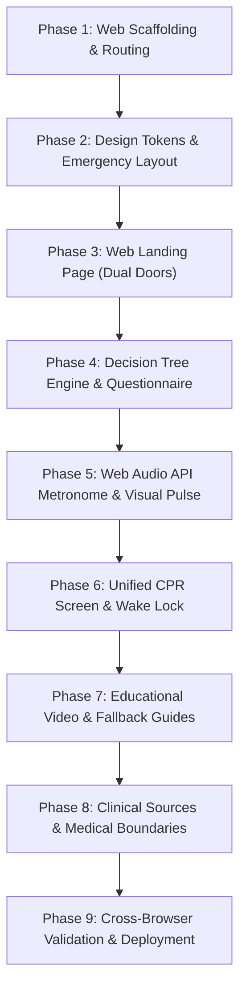

# EqualRescue — Detailed Web Implementation Plan

This is a **pure web application** implementation plan (no native iOS/Android mobile apps required). The website is built as an instant-access, mobile-responsive web tool that runs seamlessly on any device's web browser (smartphones, tablets, laptops, and desktops) directly via URL or QR code, requiring zero downloads, zero app store installations, and zero user accounts.

---

## 1. Web Architecture & Tech Stack

| Layer | Technology | Purpose | Why this Choice |
|---|---|---|---|
| **Core Framework** | **React 18+ & Vite** | SPA Front-end | Lightning-fast initial load (< 500ms), instant HMR, modern web APIs |
| **Language** | **TypeScript** | Strict typing | Compile-time safety for decision tree nodes and state machines |
| **Styling** | **Modern Vanilla CSS (Custom Properties)** | Design System | Maximum control, zero runtime overhead, guaranteed fast rendering |
| **Web Routing** | **React Router DOM (v6)** | Browser URL routing | Clean routes (`/`, `/decide`, `/cpr`, `/learn`, `/sources`) |
| **Audio Engine** | **Web Audio API** | Metronome (100–120 bpm) | Look-ahead web scheduling immune to `setInterval` timer drift |
| **Display API** | **Screen Wake Lock API** | Screen persistence | Prevents phone/laptop display from dimming during active CPR |
| **Data Engine** | **Static JSON Walker** | Decision Engine | Clinically auditable, version-controlled, zero AI hallucination risk |
| **Testing** | **Vitest + Testing Library** | Unit & Component testing | Automated traversal of every single decision branch |
| **Deployment** | **Static Web Hosting (Vercel / Netlify)** | Public web access | Instant HTTPS, global CDN, shareable via printed QR codes |

---

## 2. Web Project Directory Structure

```text
equalrescue/
├── index.html                           # Web entry with meta tags, viewport & preconnects
├── package.json
├── tsconfig.json
├── vite.config.ts
├── public/
│   ├── favicon.svg
│   └── sounds/
│       └── metronome-click.wav          # Clean fallback audio click
└── src/
    ├── main.tsx                         # Web DOM mount
    ├── App.tsx                          # Router provider & layout shell
    ├── index.css                        # CSS variables, typography, reset
    │
    ├── types/
    │   ├── decision.ts                  # Question, Answer, Advice, Tree types
    │   └── emergency.ts                 # Metronome, timer, call state types
    │
    ├── data/
    │   ├── decision-tree.json           # Clinically reviewed decision logic
    │   └── cpr-content.json             # AHA-aligned hands-only CPR step copy
    │
    ├── hooks/
    │   ├── useMetronome.ts              # Web Audio API look-ahead scheduler
    │   ├── useStopwatch.ts              # High-precision Date.now() delta timer
    │   ├── useWakeLock.ts               # navigator.wakeLock screen keep-awake
    │   └── useDecisionTree.ts           # State machine to traverse decision JSON
    │
    ├── components/
    │   ├── common/
    │   │   ├── WebNavbar.tsx            # Web header with logo & navigation links
    │   │   ├── EmergencyCallBar.tsx     # Pinned Call 112 bar with desktop fallback
    │   │   ├── SafetyBanner.tsx         # Visible medical limitation disclaimer
    │   │   └── WebFooter.tsx            # Quick links, source attribution & credits
    │   ├── cpr/
    │   │   ├── MetronomePulse.tsx       # Synchronized CSS visual beat ring
    │   │   ├── ElapsedTimer.tsx         # High-contrast mm:ss counter
    │   │   ├── InstructionStepCard.tsx  # Step-by-step CPR visual guidance
    │   │   └── AedReminderBanner.tsx    # "Send for AED" alert banner
    │   └── decision/
    │       ├── QuestionCard.tsx         # Single question focus card
    │       └── DecisionProgress.tsx     # Breadcrumb / back navigation
    │
    └── pages/
        ├── LandingPage.tsx              # "/" - Dual primary entry doors
        ├── DecisionPage.tsx             # "/decide" - Step-by-step guidance
        ├── CprScreen.tsx                # "/cpr" - Active CPR rhythm & timer
        ├── LearnPage.tsx                # "/learn" - AHA woman-featured tutorial
        └── SourcesPage.tsx              # "/sources" - Clinical guidelines & safety
```

---

## 3. Detailed 9-Phase Implementation Roadmap



---

### Phase 1: Project Scaffolding & Web Routing
**Objective:** Set up a clean, ultra-fast TypeScript web application skeleton with client-side routing.

1. **Scaffold with Vite:**
   - Initialize React 18 + TypeScript inside `C:\Users\DELL\.gemini\antigravity-ide\scratch\equalrescue`.
   - Configure `vite.config.ts` for clean asset bundling and quick startup.
2. **Setup Client-Side Routing (`react-router-dom`):**
   - Configure browser routes:
     - `/` — Web Landing Page
     - `/decide` — Interactive Decision Support Flow
     - `/cpr` — Active CPR Guidance Screen
     - `/learn` — Woman-Featured Video Tutorial & FAQs
     - `/sources` — Clinical Evidence & Disclaimers
3. **HTML Head Optimization (`index.html`):**
   - Proper responsive viewport tag (`width=device-width, initial-scale=1.0, maximum-scale=5.0`).
   - Descriptive title: *"EqualRescue — Women-Centred CPR Emergency Guidance"*.
   - Google Fonts preconnect (`Outfit` or `Inter` for optimal legibility).
4. **Verification for Phase 1:**
   - Dev server runs cleanly via `npm run dev`.
   - All 5 routes load without console errors or 404s.

---

### Phase 2: Design System & Persistent Emergency Shell
**Objective:** Build an accessible, high-contrast, women-centred web design system with a pinned emergency call bar.

1. **CSS Custom Properties (`index.css`):**
   - Palette Tokens:
     - Emergency Accent: High-contrast alert red (`#DC2626` / `#EF4444`) for `Call 112`.
     - Women-Centred & Reassuring Tones: Warm rose-tinted slates (`#FFF1F2`, `#FFE4E6`, `#9F1239`).
     - Neutrals: Deep charcoal/slate for maximum contrast (`#0F172A`, `#1E293B`, `#334155`).
     - High Legibility: Minimum 16px body, 24px–32px for emergency action prompts.
2. **Persistent Emergency Call Bar (`EmergencyCallBar.tsx`):**
   - Always visible, pinned at top/bottom across all pages.
   - On mobile web browsers: Direct `tel:112` clickable action.
   - On desktop web browsers: Shows `Call 112` prominently with a "Copy Emergency Number" tooltip and clear instructions to use a nearby phone.
3. **Global Navigation & Safety Banner (`WebNavbar.tsx`, `SafetyBanner.tsx`):**
   - Clean top navigation with site branding, quick links (`CPR`, `Decide`, `Learn`, `Sources`).
   - Subtle persistent safety tag: *"Educational emergency guidance prototype. Always prioritize calling 112."*
4. **Verification for Phase 2:**
   - Test contrast ratio against WCAG AAA standards (7:1 for text).
   - Ensure the call bar stays pinned and does not obscure content on small mobile screens or large monitors.

---

### Phase 3: Web Landing Page ("The Two Front Doors")
**Objective:** Create a distraction-free, zero-login homepage that allows users to act within 2 seconds.

1. **Hero Section:**
   - Clear value proposition: *"Clear steps. Faster action. CPR guidance with women in mind."*
   - Brief reassurance: *"CPR on a woman is performed the same way as on a man. Act immediately."*
2. **The Two Primary Interactive Cards:**
   - **Card A ("Help me decide" - `/decide`):**
     - Designed for the hesitant bystander.
     - Subtext: *"Not sure if the person is responsive or breathing? We will guide you through simple checks."*
   - **Card B ("I know CPR is needed" - `/cpr`):**
     - High-urgency direct shortcut.
     - Subtext: *"Person is unresponsive and not breathing normally. Go straight to compressions & timer."*
3. **Quick Awareness Strip:**
   - Brief 3-item insight strip explaining why bystander CPR is delayed for women (fear of touching chest, fear of causing harm, Good Samaritan protection in India).
4. **Verification for Phase 3:**
   - Lighthouse accessibility check.
   - Zero login walls, cookie prompts, or popups delaying the user.

---

### Phase 4: Deterministic Decision Tree Flow (`/decide`)
**Objective:** Guide unsure bystanders through observable facts using a verified JSON tree (no AI hallucination risks).

1. **Decision Tree Data Structure (`decision-tree.json`):**
   - Node 1: *Responsiveness Check*
     - "Does the person respond when you firmly tap their shoulders and shout?"
     - Options: `Yes` | `No` | `Not sure`
     - If `Yes`: Stay with them, monitor, wait for 112.
     - If `No` or `Not sure`: Proceed to Node 2.
   - Node 2: *Breathing Check*
     - "Are they breathing normally? (Listen for gasping or no breath at all)"
     - Options: `Yes, breathing normally` | `No breath or only gasping` | `Not sure`
     - If `Yes`: Recovery position, monitor, follow dispatcher.
     - If `No` or `Not sure`: **Immediate redirect to CPR Screen (`/cpr`)**.
2. **Decision Walker Hook & Component (`useDecisionTree.ts`, `QuestionCard.tsx`):**
   - Tracks current node, history stack, and choice breadcrumbs.
   - Large touch-friendly answer buttons (minimum height 60px).
   - "Back" button to step backward and "Start Over" button.
3. **Verification for Phase 4:**
   - Automated test walking all possible permutations: ensure 100% of branches resolve safely and no dead-ends exist.

---

### Phase 5: High-Precision Web Audio Metronome & Visual Pulse
**Objective:** Build a rock-solid, drift-free audio and visual metronome at 100–120 bpm utilizing native browser APIs.

1. **Web Audio Scheduler (`useMetronome.ts`):**
   - Use standard `AudioContext` with an advance look-ahead scheduling loop (scheduling beeps 100ms ahead using `audioContext.currentTime`).
   - Default frequency: 110 beats per minute (sweet spot of the AHA 100–120 bpm window).
   - Audio unlock: Resume suspended `AudioContext` on user's first click (satisfies browser autoplay policies).
2. **Visual Beat Ring (`MetronomePulse.tsx`):**
   - CSS `@keyframes` pulse ring radiating with every tick.
   - Designed for loud environments or when phone/laptop speakers are muted.
3. **Controls:**
   - Simple Start/Pause toggle.
   - Mute sound toggle (keeps the visual pulse active).
4. **Verification for Phase 5:**
   - Test for audio drift over 5 continuous minutes across browsers.
   - Ensure visual pulse stays exactly synchronized with audio clicks.

---

### Phase 6: The Full Emergency CPR Screen (`/cpr`)
**Objective:** Assemble the mission-critical emergency screen combining timer, metronome, instructions, and AED reminder.

1. **Precision Stopwatch (`useStopwatch.ts`, `ElapsedTimer.tsx`):**
   - High-contrast `mm:ss` elapsed timer computed using `Date.now() - startTime` delta rendered every 250ms.
   - Clear Start, Pause, and Reset buttons.
2. **Step-by-Step Hands-Only Instructions (`InstructionStepCard.tsx`):**
   - Step 1: Hand Placement — Center of the chest, right between the breasts. Heel of one hand, other hand interlocked on top.
   - Step 2: Push Hard & Fast — Push down at least 2 inches (5 cm), allow complete chest recoil.
   - Step 3: Keep going until emergency personnel or an AED arrives.
3. **AED Alert Banner (`AedReminderBanner.tsx`):**
   - High-visibility banner: *"Send someone to find an Automated External Defibrillator (AED). As soon as it arrives, turn it on and follow its voice instructions."*
4. **Screen Wake Lock Integration (`useWakeLock.ts`):**
   - Automatically request `navigator.wakeLock.request('screen')` when entering the CPR screen to prevent phone/laptop screens from timing out during chest compressions.
5. **Verification for Phase 6:**
   - Verify all elements fit within mobile viewports without requiring scrolling during compressions.
   - Test screen wake lock on supported mobile web browsers (Chrome/Edge/Safari).

---

### Phase 7: Educational Video & Women-Centred Tutorial (`/learn`)
**Objective:** Provide structured public training and myth-busting content without obstructing emergency workflows.

1. **AHA Video Embed & Text Fallback (`LearnPage.tsx`):**
   - Embed official American Heart Association Hands-Only CPR video featuring a woman.
   - Responsive 16:9 iframe container.
   - Comprehensive text and illustrated fallback for slow connections or offline viewers.
2. **Women's CPR Myth-Busting & Reassurance Guide:**
   - Myth 1: *"CPR on women requires different techniques."* -> Fact: Standard adult CPR is identical for all sexes.
   - Myth 2: *"Touching a woman's chest in an emergency will lead to legal trouble."* -> Fact: Good Samaritan laws protect emergency responders attempting to save a life.
   - Myth 3: *"Women are too fragile for chest compressions."* -> Fact: Compressions must be firm (5 cm depth) regardless of body build.
3. **Verification for Phase 7:**
   - Video player gracefully displays fallback if network is restricted or offline.

---

### Phase 8: Clinical Sources & Medical Boundaries (`/sources`)
**Objective:** Maintain maximum medical transparency, ethical boundaries, and clinical credibility.

1. **Guidelines & Citations Table:**
   - American Heart Association (AHA) Adult Basic Life Support (BLS) Guidelines.
   - Resuscitation Council of India / National 112 ERSS.
   - Gender disparity research papers cited in the whitepaper (Circulation, JAHA, Duke).
2. **Explicit Medical Disclaimers:**
   - Clearly state: Not a diagnostic device, does not measure chest compression depth or recoil.
   - Instructions must always yield to instructions from the 112 emergency dispatcher.
3. **Review & Changelog Ledger:**
   - Document versioning, review status, and clinical oversight criteria.
4. **Verification for Phase 8:**
   - Ensure all citations include direct, clickable web links to primary scientific and governmental literature.

---

### Phase 9: Cross-Browser Validation, Performance & Deployment
**Objective:** Guarantee high-speed performance across all web browsers and deploy for public web access.

1. **Cross-Browser & Device Testing:**
   - Test responsive breakpoints: Mobile (320px–480px), Tablet (768px), Desktop (1024px+).
   - Test across Chrome, Safari (iOS/macOS), Firefox, and Edge.
2. **Web Performance Optimization:**
   - Zero unnecessary external dependencies.
   - Target 100/100 Lighthouse Performance score and 100/100 Accessibility score.
3. **Public Deployment:**
   - Setup Vercel or Netlify static build (`npm run build`).
   - Generate high-resolution QR codes linking directly to the live website URL for easy offline sharing.

---

## 4. Next Step to Begin

We will begin with **Phase 1**:
1. Scaffold the project in `C:\Users\DELL\.gemini\antigravity-ide\scratch\equalrescue`.
2. Install the necessary packages (`react-router-dom`, `lucide-react`).
3. Set up the baseline web router.
