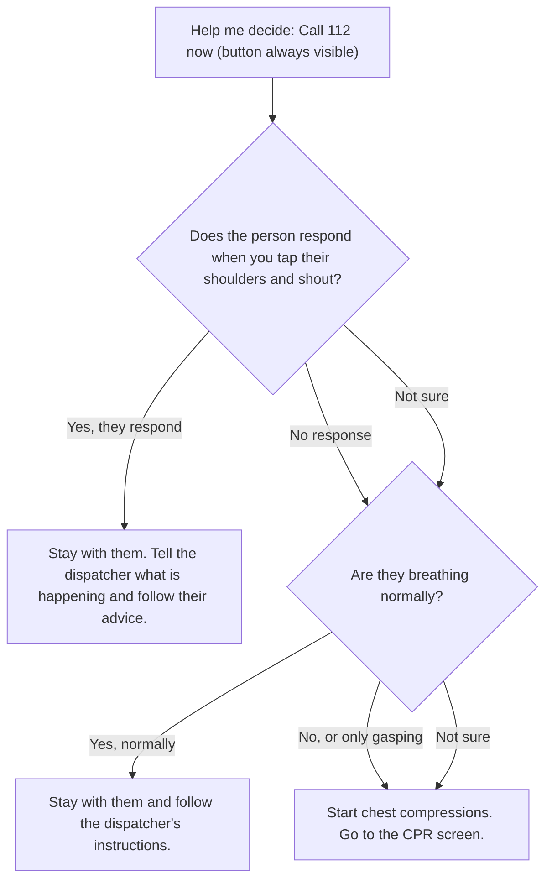

# EqualRescue — Whitepaper

### A Women-Centred, CPR-First Emergency Guidance Website

| | |
|---|---|
| **Document type** | Project whitepaper (hackathon prototype) — v2, aligned to the final 5-phase interface plan |
| **Product format** | Mobile-first website / Progressive Web App (PWA), no login |
| **Domain** | Women's healthcare · Emergency response · Health awareness |
| **Team** | 2 members — `[Your Name]` (Frontend & UX), `[Teammate Name]` (Content, Decision Logic & Testing) |
| **Version / Date** | 2.0 (draft) · 24 October 2026 |
| **Tagline** | *Clear steps. Faster action. CPR guidance with women in mind.* |

> **Safety notice:** EqualRescue is an educational guidance prototype, not a clinical protocol or diagnostic tool. It does not replace emergency services, dispatcher instructions, an AED, or certified CPR training. All instructions must be reviewed by a qualified clinician or certified CPR instructor against current AHA adult basic life support guidelines and local guidance before any real-world use.

---

## Table of Contents

1. [Abstract](#1-abstract)
2. [Executive Summary](#2-executive-summary)
3. [Detailed Problem Statement](#3-detailed-problem-statement)
4. [Market Landscape and Competition](#4-market-landscape-and-competition)
5. [Our Solution and Final Interface](#5-our-solution-and-final-interface)
6. [How EqualRescue Differs from Existing Solutions](#6-how-equalrescue-differs-from-existing-solutions)
7. [Target Users](#7-target-users)
8. [Detailed Screen Specifications](#8-detailed-screen-specifications)
9. [Decision Flow Design](#9-decision-flow-design)
10. [Clinical Safety and Medical Boundaries](#10-clinical-safety-and-medical-boundaries)
11. [Tech Stack](#11-tech-stack)
12. [System Architecture](#12-system-architecture)
13. [Design, Accessibility and Women-Centred Approach](#13-design-accessibility-and-women-centred-approach)
14. [Development Plan: The Five Phases](#14-development-plan-the-five-phases)
15. [MVP Scope](#15-mvp-scope)
16. [Team Plan](#16-team-plan)
17. [Testing and Validation Plan](#17-testing-and-validation-plan)
18. [Success Metrics](#18-success-metrics)
19. [Privacy and Ethics](#19-privacy-and-ethics)
20. [Risks and Mitigations](#20-risks-and-mitigations)
21. [Impact and Go-to-Market](#21-impact-and-go-to-market)
22. [Roadmap](#22-roadmap)
23. [Pitch and Demo Plan](#23-pitch-and-demo-plan)
24. [Definition of Done](#24-definition-of-done)
25. [References](#25-references)
26. [Appendix](#26-appendix)

---

## 1. Abstract

When an adult suddenly collapses, a bystander's first minutes of action can matter enormously, yet many people freeze, are unsure whether CPR is needed, or hesitate because they fear causing harm. Research from several countries also indicates that women are less likely than men to receive bystander CPR in public places, and public perceptions point to fear of touching a woman's chest and fear of causing injury.

**EqualRescue** is a lightweight, login-free website that tackles these barriers in the simplest possible way:

1. A **landing page** with two clear paths — **"Help me decide"** and **"I know CPR is needed"** — and an always-visible emergency call button, in a women-centred design.
2. A **predefined decision tree** (plain JavaScript, no AI) that leads to clinically reviewed instructions.
3. A **CPR screen** with large readable instructions, a working timer, a 100–120/min metronome, an AED reminder and a clear way back to the emergency guidance.
4. An **embedded or linked existing tutorial** — a reputable American Heart Association Hands-Only CPR video featuring a woman — instead of producing unreviewed medical video.
5. A **test-and-polish** phase checking every branch, the mobile layout, the timer, the video and the emergency-call link, with the clinical flow checked against current AHA adult basic life support guidelines.

The product intentionally invents no medical advice, makes no diagnosis, and does not depend on a server or AI model in an emergency.

---

## 2. Executive Summary

| | |
|---|---|
| **Problem** | Bystanders are often unsure what to do or whether CPR is needed; women appear less likely to receive bystander CPR in public, and CPR education has historically under-represented women. |
| **Solution** | A fast, no-login website that helps a user decide the next step, shows reviewed CPR/AED guidance with a timer and metronome, and links a trusted video of CPR performed on a woman. |
| **Key innovation** | A *"Help me decide"* path for hesitant bystanders, combined with an integrated CPR screen and a women-centred experience, built entirely on reviewed content. |
| **Differentiator** | Emergency-first simplicity + women-centred design + clinically reviewed decision tree + trusted existing video + transparency about limits. |
| **Tech approach** | Static front-end (React or vanilla JS), JSON decision tree, Web Audio metronome, optional PWA caching. No backend needed for the core product. |
| **What we do not claim** | First CPR app; detecting cardiac arrest; proving CPR effectiveness; diagnosis; improving survival. |

---

## 3. Detailed Problem Statement

### 3.1 Cardiac arrest is a time-critical bystander problem

Cardiac arrest is the sudden loss of effective heart function. Without circulation, brain injury begins within minutes, and emergency responders usually cannot arrive instantly. The bystander is therefore the first responder. Standard guidance centres on calling emergency services, starting chest compressions, and using an AED as soon as one is available.

### 3.2 Bystanders hesitate, doubt, or forget

At the scene of a collapse a bystander may:

- Not know if the person is unresponsive or breathing normally — **the "do I need CPR?" question.**
- Fear doing CPR wrongly or causing injury.
- Forget the sequence: call → compress → AED.
- Not remember compression rate or hand position.
- Be unable to read long articles or watch long videos under stress.

This is why the interface offers two entry points: one for people who already know CPR is needed, and one for people who are unsure.

### 3.3 The women-specific gap

| Finding | Source (verify before final pitch) |
|---|---|
| In a US analysis of 19,331 cardiac events (2011–2015), 45% of men and 39% of women received bystander CPR in public; at home the rates were about equal (36% vs 35%). | Blewer et al., 2018, summarized by the AHA |
| A national survey found three public-perception themes for why women get less CPR: sexualization of women's bodies, belief that women are frail, and misperceptions about women in acute distress. | *Circulation*, 2019;139(8):1060–1068 |
| Larger US analysis (~309,000 cases, 2013–2019): women were about 14% less likely to receive bystander CPR and defibrillation. | Duke / *Journal of the American Heart Association* |
| AHA tracking study: 46% of women vs 54% of men said they would likely give Hands-Only CPR in an emergency. | AHA Hands-Only CPR Research Tracking Study (secondary reports) |
| AHA guidelines call for CPR training to address gender-related barriers to improve bystander CPR for women. | AHA 2020 guidelines |
| AHA states that performing CPR on a woman's chest is the same as on a man's, and that Good Samaritan laws protect people who help. | AHA Hands-Only CPR page — check local (Indian) legal position separately |

**Scientific caution:** These are observational findings; effect sizes vary by setting and year, and reasons are partly inferred from perceptions. CPR guidance depends on the person's condition, not sex. EqualRescue therefore does **not** create a different CPR protocol for women; it improves **confidence, representation and decision support.**

### 3.4 The Indian context

- India does not have a formal national cardiac-arrest registry or a centralized emergency medical system, according to published OHCA literature.
- Studies report low bystander CPR in India; one tertiary-centre study reported 9.8%, and commentary citing the Cardiological Society of India gives an estimated range of 1.3%–9.8%. Some registries reviewed in the literature reported very few or no bystander CPR cases.
- Commentary also reports that under 2% of the population is formally CPR-trained.
- India's unified emergency number is **112**.

> Quote each figure individually with its source, year and population. They come from different studies and show a *direction*, not one precise national number.

### 3.5 The interface gap

Existing resources are often long videos, dense articles, courses that cannot be accessed mid-emergency, or broad first-aid apps. A person in distress needs **short, immediate, one-step-at-a-time prompts with a visible timer and a steady rhythm**, plus help deciding *whether* CPR is needed. These are hypotheses to confirm in the competitor audit (Section 4.4).

### 3.6 Formal problem statement

> **How might we help a hesitant or untrained bystander decide the next step and perform CPR in line with reviewed guidance during a suspected adult cardiac arrest, using a simple, no-login, women-centred website that removes common barriers such as uncertainty, fear and lack of trained examples?**

### 3.7 Alignment with the Women's Healthcare problem statement

| Theme | How EqualRescue contributes |
|---|---|
| Closing gaps in care | Targets the documented gap in bystander CPR for women |
| Health awareness | Women-centred design and a trusted video featuring a woman |
| Access | No login, mobile-first, lightweight, free |
| Reliable clinical information | Decision tree and instructions reviewed against AHA guidelines; sources displayed |

---

## 4. Market Landscape and Competition

### 4.1 Categories of alternatives

1. General first-aid apps with CPR sections.
2. Community-responder and AED-locator apps.
3. CPR training and feedback apps.
4. Instructor-led courses and training equipment.
5. Passive resources (videos, articles) and dispatcher-assisted CPR over the phone.

### 4.2 Known players

| Player | Category | Public description | Relation to EqualRescue |
|---|---|---|---|
| **American Red Cross — First Aid app** | General first aid | Free step-by-step first-aid guidance and videos, hospital finder, CPR practice metronome, quizzes with badges | Closest consumer app; broad scope, not a single emergency flow with a "decide" path |
| **IFRC — First Aid** | General first aid | Red Cross Red Crescent first-aid app | Global content reference |
| **PulsePoint Respond / PulsePoint AED** | Responder alerts / AED locator | Alerts CPR-trained volunteers to nearby public cardiac arrests; crowd-sourced AED map | Complementary; relies on agency partnerships and trained users |
| **Pocket First Aid & CPR** | First aid / CPR reference | AHA-aligned content for adult, child and infant CPR with videos and illustrations | Reference-style rather than minimal emergency flow |
| **PocketCPR** | CPR guidance and feedback | Real-time CPR instruction and feedback | Closest on live guidance; EqualRescue does not claim to measure CPR quality |
| **AHA Hands-Only CPR resources & video featuring a woman** | Education | Short training videos, including one with a woman as the patient and an anatomically realistic manikin | **We reuse this, not compete** — it is our Phase 4 tutorial |
| **Womanikin** | Training equipment | Vest with silicone breasts that fits standard CPR manikins | Same representation goal in physical training; potential partner |
| **Certified courses (AHA, Red Cross, local)** | Instructor-led | Hands-on training | Gold standard; we complement them |
| **Dispatcher-assisted CPR (112)** | Emergency service | Live instruction from trained dispatchers | Always the authority |

> Based on public descriptions found in preliminary research; features change. Verify during the audit.

### 4.3 Preliminary competitive matrix

Legend: ✔ described publicly · ◐ partial/unclear · ✘ not offered · ? **not yet verified**

| Capability | Red Cross First Aid | Pocket First Aid & CPR | PocketCPR | PulsePoint | AHA video only | **EqualRescue** |
|---|:-:|:-:|:-:|:-:|:-:|:-:|
| Single-purpose emergency CPR path | ◐ | ◐ | ✔ | ✘ | ✘ | ✔ |
| **"Help me decide" decision path** | ? | ? | ? | ✘ | ✘ | ✔ |
| CPR metronome | ✔ | ? | ? | ✘ | ✘ | ✔ |
| Timer on the CPR screen | ? | ? | ? | ✘ | ✘ | ✔ |
| AED reminder | ◐ | ? | ? | ✔ (locator) | ◐ | ✔ |
| Woman-featured tutorial | ? | ? | ? | ✘ | ✔ | ✔ (embedded/linked) |
| Women-centred interface design | ? | ? | ? | ✘ | n/a | ✔ |
| No login | ? | ? | ? | ? | ✔ | ✔ |
| Shows 112 / India-specific | ? | ? | ? | ✘ | ✘ | ✔ |
| Visible clinical sources per step | ? | ? | ? | ? | ◐ | ✔ |

**Do not claim a gap until the "?" cells are verified.**

### 4.4 Competitor audit plan

Test 3–5 apps/sites and record: taps/seconds to first instruction; whether there is a decision aid for unsure bystanders; offline access; voice and rhythm; AED handling; representation of women; languages and accessibility; sources and update dates. Save in `docs/competitor-audit.md` and update Section 4.3.

### 4.5 Where the opportunity is

- **Decision support for the hesitant bystander**, not only instructions for someone who already decided.
- **One lightweight screen** combining timer, metronome and AED reminder.
- **Women-centred design with a trusted woman-featured video.**
- **Transparency** — visible sources and review status.
- **Local fit** — 112, Indian-language roadmap, no-install web access via QR code.

### 4.6 Competitive risks

- Established brands have strong medical credibility; we earn trust via AHA-based content, expert review and clear sourcing.
- People rarely install emergency apps before they need them; we rely on QR codes, colleges, NGOs and instructors for reach.
- Our strongest dependency is on AHA content staying available and licensed for linking/embedding.

---

## 5. Our Solution and Final Interface

The interface is built in **five phases**, which together form the final website.

### 5.1 Overview

```text
Landing page
 ├── "Help me decide"  ──► Decision flow (predefined tree) ──► reviewed instruction / CPR screen
 └── "I know CPR is needed" ───────────────────────────────► CPR screen
                                                              ├── Timer + 100–120/min metronome
                                                              ├── AED reminder
                                                              ├── Return to emergency guidance
                                                              └── Existing AHA tutorial (woman featured)
Always visible: Emergency call button (112) · No login · Safety notice
```

### 5.2 The five phases at a glance

| Phase | Name | What gets built |
|---|---|---|
| **1** | Main website | Landing page with two clear options — **"Help me decide"** and **"I know CPR is needed"**; visible emergency call button; women-centred design; no-login access |
| **2** | Decision flow | Small predefined decision tree in JavaScript leading to clinically reviewed instructions based on the answers — it never invents medical advice |
| **3** | CPR screen | Large readable instructions, working timer, 100–120/min metronome, AED reminder, clear option to return to emergency guidance; rhythm and timer tested on a phone |
| **4** | Existing tutorial | Embed or link a reputable existing CPR training video featuring a woman — the AHA Hands-Only CPR video featuring a woman |
| **5** | Test and polish | Test every answer branch, mobile layout, timer start/stop, video access and emergency-call link; clinical flow checked against current AHA adult basic life support guidelines |

### 5.3 Design principles

1. **Call first.** The call button is visible on every screen.
2. **Two doors in.** One for people who know, one for people who are unsure.
3. **Reviewed, not generated.** Instructions come from a version-controlled decision tree; no AI in the emergency path.
4. **No login, no friction.**
5. **Women-centred, not women-different.** Representation and tone are inclusive; the CPR technique shown is the same standard adult technique.
6. **Reuse trusted content** (AHA video) instead of producing unreviewed medical media.
7. **Honest about limits.**

---

## 6. How EqualRescue Differs from Existing Solutions

### 6.1 Side-by-side

| Dimension | Typical existing approach | EqualRescue |
|---|---|---|
| Entry experience | Menus, search, long video, or a login | Two big buttons: **Help me decide** / **I know CPR is needed**, plus a visible call button |
| Handling uncertainty | Assume the user already knows CPR is needed | Dedicated decision flow for unsure bystanders |
| CPR support during action | Metronome, timer, AED info often separate or practice-only | One screen: instructions + timer + metronome + AED reminder + back-to-guidance |
| Women's representation | Not consistently addressed (to be verified) | Women-centred design and AHA video featuring a woman |
| Medical content | Varies; sometimes loosely sourced | Predefined, reviewed tree checked against AHA adult BLS guidelines; sources visible |
| Video | Many external or long videos | One short, reputable, woman-featured AHA video |
| Dependency | Install, account, internet, or AI | No login; core logic is local JavaScript; optional PWA caching |
| AI use | Increasingly common | None in emergency instructions, deliberately |
| Claims | Sometimes outcome marketing | Only usability and comprehension are measured |

### 6.2 Positioning statement

> **EqualRescue is a women-centred, no-login CPR guidance website that helps hesitant bystanders decide what to do, then supports them with reviewed instructions, a timer, a metronome and a trusted tutorial.**

### 6.3 What EqualRescue is *not*

| It is not… | Because… |
|---|---|
| A diagnostic tool | It does not determine whether the person is in cardiac arrest; it asks simple observable questions and points to the emergency number |
| A CPR-quality sensor | It does not measure hand depth or rate |
| A replacement for the dispatcher or AED | It always defers to both |
| A different protocol for women | Standard adult guidance applies to everyone |
| An AI medical chatbot | No LLM touches the instructions |
| A certified training programme | It links to training and does not issue certificates |

### 6.4 Ranked differentiators

1. **"Help me decide"** path for the hesitant bystander.
2. **Integrated CPR screen** (timer + metronome + AED reminder + return to guidance).
3. **Women-centred design and woman-featured trusted tutorial.**
4. **Reviewed, deterministic decision tree** with visible sources.
5. **Zero-friction access** (no login, mobile-first, optional offline caching).

---

## 7. Target Users

| User | Need |
|---|---|
| **Primary — a bystander with a phone** | Quick guidance during a suspected adult cardiac arrest, including help deciding whether to start CPR |
| Hesitant helpers | Reassurance and structured decision support |
| Students and members of the public | A short, free way to learn the steps and see CPR performed on a woman |
| Colleges, community groups, instructors | A shareable awareness tool with a QR code |

**Personas**

- **Ananya, 21, student** — saw a CPR video once; wants to know what to do right now.
- **Rahul, 34, office worker** — worries about touching a woman colleague's chest; needs reassurance and clear steps.
- **Meera, 45, community health volunteer** — wants a trustworthy, simple tool to show at awareness sessions.

**Initial scope:** adult, non-traumatic suspected cardiac arrest. Pediatric, drowning, pregnancy-related, trauma-related and other special cases are out of scope until separately reviewed.

---

## 8. Detailed Screen Specifications

### 8.1 Phase 1 — Landing page

| Element | Specification |
|---|---|
| **Header** | Logo, language toggle (English first), "Sources & Safety" link |
| **Emergency call button** | Persistent, large, high-contrast `Call 112` (a `tel:112` link). The user confirms the call in their phone dialer. |
| **Primary option A** | **"I know CPR is needed"** — goes straight to the CPR screen |
| **Primary option B** | **"Help me decide"** — starts the decision flow |
| **Women-centred design** | Warm, respectful visual language; imagery that shows women as rescuers and patients; supportive, non-alarmist tone; no stereotypes |
| **No login** | No sign-up, no cookies banner beyond what is required, no data collection |
| **Safety note** | One-line statement: "This site does not replace emergency services. Call 112." |
| **Performance** | Tiny page weight; works on low-end phones and slow networks |

**Layout (mobile):** call button pinned at the top or bottom; two stacked buttons filling most of the screen; footer with sources and safety links.

### 8.2 Phase 2 — Decision flow screens

- One question per screen, large text, two or three big answer buttons.
- Persistent `Call 112` button and a "Back" control.
- Each terminal node shows a reviewed instruction and a clear next action (usually *Go to CPR screen* or *Stay with the person and follow the dispatcher*).
- Details in [Section 9](#9-decision-flow-design).

### 8.3 Phase 3 — CPR screen

| Element | Specification |
|---|---|
| **Instruction block** | Large, readable text, one action at a time; hands-only emphasis with reviewed wording |
| **Timer** | Large `mm:ss` elapsed counter with start/stop; computed from timestamps |
| **Metronome** | 100–120 beats/min (single default chosen after testing), audio beat plus visual pulse; mute option |
| **AED reminder** | Prominent banner: "Send someone for an AED. When it arrives, follow its voice instructions." No shock advice. |
| **Return to emergency guidance** | Clearly labelled control returning to the call-and-assess guidance at any time |
| **Call button** | Always visible |
| **Dispatcher banner** | "Follow the emergency dispatcher's instructions." |
| **Fallbacks** | If audio fails, the visual pulse and text remain; if the timer is stopped, it can be restarted without losing the screen |

### 8.4 Phase 4 — Tutorial section

- A short **AHA Hands-Only CPR video featuring a woman**, either embedded via the official player (if the AHA's terms allow) or **linked** to the AHA page.
- Shown as a supplementary section ("Watch how it's done"), **not** as a step the user must complete before acting during a live emergency.
- Includes a short, accurate note that standard CPR technique is the same regardless of the patient's sex, citing the AHA.
- Includes a fallback text description in case the video cannot load.

### 8.5 Phase 5 — Sources & Safety page

- Lists every instruction's source, guideline version and review status.
- States the limitations of the site and the date of last review.

---

## 9. Decision Flow Design

### 9.1 Purpose

Help a hesitant bystander move quickly from "I'm not sure" to the correct reviewed next step, **without delaying the call for help**, without diagnosis, and without asking for a pulse check.

### 9.2 Rules

- Questions are limited to **observable facts** (responding? breathing normally?).
- Default for any "unsure" answer is the **safe side**: call 112 and follow the dispatcher.
- The decision tree is stored as **data (JSON)**, reviewed and version-controlled; the code only walks the tree.
- No question blocks the call button, and the call button is on every node.

### 9.3 Draft decision tree (for clinician review — wording illustrative)



> The "Not sure" routing, the exact questions and the wording are **drafts** and must be approved by a qualified clinician or certified instructor against current AHA adult BLS guidance before use. Where reviewed guidance says to treat uncertainty as an emergency, the tree follows that guidance.

### 9.4 Data format example

```json
{
  "version": "0.1-draft",
  "guideline_source": "AHA adult BLS — TO_BE_FILLED (year, section)",
  "review_status": "pending",
  "start": "q_response",
  "nodes": {
    "q_response": {
      "type": "question",
      "text": "Does the person respond when you tap their shoulders and shout?",
      "answers": [
        { "label": "Yes", "next": "a_responsive" },
        { "label": "No", "next": "q_breathing" },
        { "label": "Not sure", "next": "q_breathing" }
      ]
    },
    "q_breathing": {
      "type": "question",
      "text": "Are they breathing normally?",
      "answers": [
        { "label": "Yes, normally", "next": "a_breathing" },
        { "label": "No, or only gasping", "next": "go_cpr" },
        { "label": "Not sure", "next": "go_cpr" }
      ]
    },
    "go_cpr": { "type": "route", "route": "/cpr" },
    "a_responsive": { "type": "advice", "text": "…reviewed text…", "source": "TO_BE_FILLED" },
    "a_breathing":  { "type": "advice", "text": "…reviewed text…", "source": "TO_BE_FILLED" }
  }
}
```

### 9.5 Engine behaviour

- A small JavaScript function loads the JSON, renders the current node, and moves to the chosen `next`.
- Includes a **"Back"** action and a **"Start over"** action.
- A unit test walks every path and verifies: every node is reachable, no dead ends, every terminal node leads to an instruction or the CPR screen, and the call button is rendered on every node.

---

## 10. Clinical Safety and Medical Boundaries

### 10.1 Hard rules

- Show the correct local emergency number: **112** for the India-focused prototype (verify before deployment).
- Never delay calling for help; the call button is on every screen.
- Do **not** ask an untrained bystander to check a pulse.
- Do **not** claim to detect cardiac arrest or consciousness.
- Do **not** claim the timer or metronome proves that CPR is effective.
- Do **not** recommend a shock; the AED analyzes and advises. Instruct users to follow the AED's voice prompts and to keep clear of the person during analysis and shock.
- Do **not** use an AI model to write, modify or improvise emergency instructions.
- No diagnosis, prognosis or survival guarantee.
- Always state that the site does not replace emergency services or formal training.
- Review all content with a qualified clinician or certified CPR instructor before real-world use.

### 10.2 Hands-only emphasis

The prototype's CPR screen centres on **hands-only CPR** for an adult in suspected cardiac arrest, in line with AHA public guidance, with the dispatcher's instructions taking priority. Rescue breaths (30:2) are not the default for untrained users; if included at all, they appear as an optional, reviewed pathway for trained and willing rescuers.

### 10.3 Content governance

| Control | Implementation |
|---|---|
| Authoritative sources | AHA adult BLS guidelines and AHA Hands-Only CPR material; 112 information from the Government of India |
| Review | Clinician/instructor sign-off tracked per version |
| Version control | Decision tree and instruction text in Git, changed only by reviewed pull requests |
| Dating | Source, guideline year and last-reviewed date shown on the Sources page |
| Freeze | No unreviewed content edits right before the demo |

### 10.4 On "women-centred" content

Women-centred means **representation, tone and reassurance**: women shown as rescuers and as patients, respectful language, and a clear statement (citing the AHA) that CPR on a woman's chest is performed the same way as on a man's. It does **not** mean different clinical steps.

---

## 11. Tech Stack

The stack is intentionally minimal. The **core product is a static, front-end-only site** with no backend and no database.

### 11.1 Stack table

| Layer | Technology | Purpose | Why |
|---|---|---|---|
| Front-end | **React + TypeScript + Vite** (or vanilla JavaScript if the team prefers the smallest footprint) | Landing, decision flow, CPR screen | Fast development; type safety for the tree; small build |
| Styling | **Tailwind CSS** or **CSS Modules** | Responsive, high-contrast, women-centred visual design | Quick theming with design tokens |
| Routing | **React Router** (or hash routing) | `/`, `/decide`, `/cpr`, `/learn`, `/sources` | Simple, works on static hosting |
| Decision logic | **JavaScript/TypeScript walker over a JSON tree** | Phase 2 decision flow | Deterministic, auditable, testable; no AI |
| Timer | `performance.now()` / `Date.now()` deltas rendered every ~250 ms | Elapsed time | Correct even if ticks are delayed |
| Metronome | **Web Audio API** with a look-ahead scheduler | 100–120/min beat | More accurate than `setInterval` |
| Visual beat | CSS animation synchronized to the scheduler | Visual fallback if audio fails | Keeps rhythm usable when muted |
| Keep-awake | **Screen Wake Lock API** (where supported) | Reduce screen sleep during CPR | Helps, but not guaranteed on all devices |
| Vibration (optional) | **Vibration API** (where supported) | Haptic beat | Limited iOS support |
| Video | Official **AHA** player embed (`<iframe>`) if permitted, otherwise an outbound link with a text fallback | Phase 4 tutorial | Reuses a trusted, reviewed source |
| PWA (optional but recommended) | Web App Manifest + Service Worker (`vite-plugin-pwa`/Workbox) | Installable, cached core pages | Improves access; claims must be honest |
| i18n | `react-i18next` | English first, Hindi later | Reviewed bundles per language |
| Testing | **Vitest**, **React Testing Library**, **Playwright**, **Lighthouse** | Branch tests, UI tests, PWA/accessibility checks | Automated protection for safety-critical logic |
| Hosting | **Vercel** or **Netlify** (HTTPS) | Public demo and QR link | Free, HTTPS (needed for service workers) |
| Version control & CI | **Git + GitHub + GitHub Actions** | Reviewed content changes, automated tests | Auditable history |
| Design | **Figma** or **Google Stitch** | Wireframes and UI | Fast iteration |
| Analytics (optional) | None by default; privacy-friendly, consented only if added later | Usage insight | Avoids data collection in an emergency tool |

### 11.2 Key technical decisions

| Decision | Rationale |
|---|---|
| **No backend for the core product** | Nothing in an emergency depends on a server |
| **Decision tree as JSON data** | Clinicians can review it without reading code |
| **No LLM or AI service** | Emergency content must be deterministic and reviewed |
| **Call link, not auto-dial** | A website cannot reliably place emergency calls on its own; `tel:112` requires the user's confirmation |
| **Visual and textual alternatives to audio** | Audio may be blocked or interrupted by browser or device |
| **Honest offline claims** | A PWA helps but cannot guarantee opening without prior load/caching |
| **Video as a supplement** | The user should never have to watch a video before acting in an emergency |

### 11.3 Metronome notes

- Choose a default within **100–120 beats per minute** after device testing.
- Schedule beats on `audioContext.currentTime` with a short look-ahead loop.
- Start the `AudioContext` on the first user tap (browser autoplay rules).
- Provide a mute control while keeping the visual pulse.
- Measure drift over several minutes on multiple phones and record tolerances.
- Never promise uninterrupted operation if the screen locks or the tab is backgrounded.

### 11.4 Timer notes

- Store the start timestamp; compute elapsed time on each render rather than incrementing a counter.
- Support start, stop and restart without leaving the CPR screen.
- Keep timer state independent from audio.

### 11.5 Optional later additions

A small FastAPI + PostgreSQL/Supabase service is only warranted if a future phase adds consented, anonymous practice analytics. It is **not** part of the final interface described here.

---

## 12. System Architecture

### 12.1 High-level

```text
Mobile browser / installed PWA
        |
        +--> Landing (/)
        |      ├── "Help me decide" ─────► Decision flow (/decide)  ◄── reviewed JSON tree
        |      └── "I know CPR is needed" ─► CPR screen (/cpr)
        |
        +--> CPR screen (/cpr)
        |      ├── Instruction block (reviewed text)
        |      ├── Timer (timestamp-based)
        |      ├── Metronome (Web Audio) + visual pulse
        |      ├── AED reminder
        |      └── "Return to emergency guidance"
        |
        +--> Tutorial (/learn)  ──► AHA Hands-Only CPR video (embed or link)
        +--> Sources & Safety (/sources)
        |
        +--> Service worker cache (static assets + reviewed content)

No server calls required for core functionality.
```

### 12.2 Component map

| Component | Responsibility |
|---|---|
| `LandingPage` | Two primary choices, call button, safety note |
| `EmergencyCallButton` | Persistent `tel:112` link on all screens |
| `DecisionFlow` | Renders the current node from the JSON tree |
| `QuestionCard` / `AdviceCard` | Question and result views |
| `CprScreen` | Container for the CPR experience |
| `InstructionBlock` | Large reviewed instruction text |
| `ElapsedTimer` | Start/stop timer |
| `Metronome` | Audio + visual beat, mute |
| `AedReminder` | AED banner and "follow the device" text |
| `ReturnToGuidance` | Returns to the call-and-assess guidance |
| `TutorialVideo` | AHA video embed/link with fallback |
| `SourcesPage` | Sources, review status, dates |
| `SafetyBanner` | Persistent scope and limitations message |
| `AccessibilityControls` | Text size, contrast, sound, language |

### 12.3 Suggested repository structure

```text
equalrescue/
├── src/
│   ├── components/
│   ├── pages/            # Landing, Decide, Cpr, Learn, Sources
│   ├── logic/            # decision engine, timer, metronome
│   ├── content/          # decision-tree.json, instructions.json (reviewed)
│   ├── i18n/
│   └── styles/
├── public/               # icons, audio, manifest
├── tests/                # branch tests, timer tests, e2e
├── docs/
│   ├── whitepaper.md
│   ├── competitor-audit.md
│   ├── content-review-log.md
│   └── test-reports/
└── .github/workflows/
```

### 12.4 Offline strategy

Pre-cache the app shell, the decision tree, instructions and audio on first load; show an "available offline" indicator only after cache verification; explain limits plainly (must have been loaded or installed at least once; browsers may clear caches). The embedded video will **not** work offline; the text fallback does.

---

## 13. Design, Accessibility and Women-Centred Approach

### 13.1 Visual direction

| Aspect | Direction |
|---|---|
| Mood | Calm, warm, respectful — urgent only where it must be (the call button) |
| Colour | A strong, high-contrast emergency colour for the call button; a softer, women-centred palette elsewhere; always meeting contrast requirements |
| Imagery | Women shown as rescuers and as patients, in varied ages and attire; no sexualized or alarmist visuals |
| Typography | Large, legible sans-serif; 24 px or larger for instructions |
| Tone | Short, plain, reassuring sentences ("You can do this. Call 112 first.") |

### 13.2 Interaction principles

- Fewest taps from landing to first instruction (target: one tap to the CPR screen, one to start the decision flow).
- Thumb-friendly layout; large touch targets in the lower half of the screen.
- Persistent call button and dispatcher reminder.
- "Back" and "Start over" always available.
- No pop-ups, sign-in walls or autoplay video.

### 13.3 Accessibility checklist

- Contrast ratios meeting WCAG guidance, especially on the CPR screen.
- Scalable text; respect the device font-size setting.
- Screen-reader labels, keyboard operability and logical focus order.
- Visual alternatives to audio and text alternatives to the video.
- Reduced-motion option that keeps a non-animated beat indicator.
- Test with TalkBack/VoiceOver and a colour-blindness simulator.

### 13.4 Localization

English for the MVP; Hindi and other Indian languages later. Each language bundle needs clinical/instructor review; no machine-only translation of medical text.

### 13.5 Women-centred content guidelines

- Present the evidence on the gender gap accurately and without overstating it.
- State clearly that CPR on a woman is performed the same way as on anyone, citing the AHA.
- Address common fears respectfully (fear of touching, of causing injury, of legal trouble) using AHA statements, and check the local legal position before saying anything about legal protection in India.

---

## 14. Development Plan: The Five Phases

### Phase 1 — Main website

**Goal:** A landing page with two clear options and a visible emergency call button.

| Task | Owner | Done when |
|---|---|---|
| Wireframe landing page (mobile first) | Person 1 | Reviewed in Figma |
| Build page with **"Help me decide"** and **"I know CPR is needed"** | Person 1 | Both buttons route correctly |
| Add persistent `tel:112` emergency button | Person 1 | Opens dialer on test phones |
| Women-centred visual design | Person 1 | Palette and imagery approved by both |
| Ensure no login / no data collection | Both | No auth, no trackers |

### Phase 2 — Decision flow

**Goal:** A small predefined decision tree in JavaScript that leads to clinically reviewed instructions based on the answers, and never invents medical advice.

| Task | Owner | Done when |
|---|---|---|
| Draft tree from AHA adult BLS guidance | Person 2 | Draft tree documented with sources |
| Clinician/instructor review | Person 2 | Review logged |
| Implement engine and screens | Person 1 + 2 | Every node renders; Back/Start over work |
| Unit-test all paths | Person 2 | No dead ends; call button on every node |

### Phase 3 — CPR screen

**Goal:** Large readable instructions, a working timer, a 100–120/min metronome, an AED reminder, and a clear option to return to the emergency guidance — tested on a phone.

| Task | Owner | Done when |
|---|---|---|
| Instruction block with reviewed text | Person 2 → 1 | Text matches reviewed content |
| Timer start/stop | Person 1 | Accurate over several minutes |
| Metronome (Web Audio) and visual pulse | Person 1 | Rate verified within 100–120/min on target phones |
| AED reminder banner | Person 1 | Wording reviewed |
| "Return to emergency guidance" | Person 1 | Works from any state |
| Real-phone testing (audio, lock screen, tab switch) | Both | Findings logged; limitations documented |

### Phase 4 — Existing tutorial

**Goal:** Embed or link a reputable, existing CPR training video featuring a woman — the AHA Hands-Only CPR video featuring a woman.

| Task | Owner | Done when |
|---|---|---|
| Locate the exact AHA video and confirm embed/link terms | Person 2 | Terms noted; link recorded |
| Add embed or link with a text fallback | Person 1 | Works on mobile; fails gracefully |
| Add short, sourced note that CPR technique is the same for all adults | Person 2 | Wording matches AHA statement |
| Place video as a supplement, not a prerequisite | Both | No flow requires watching it |

### Phase 5 — Test and polish

**Goal:** Test every answer branch, mobile layout, timer start/stop, video access and emergency-call link; get the clinical flow checked against the current AHA adult basic life support guidelines.

| Task | Owner | Done when |
|---|---|---|
| Test every decision-tree branch | Person 2 | Test report with all paths |
| Mobile layout checks (small and large phones) | Person 1 | No overflow; readable at default and large text |
| Timer start/stop and metronome re-test | Both | Passes on target devices |
| Video access test (online/offline/fallback) | Person 1 | Fallback works |
| Emergency-call link test | Both | `tel:112` works; no screen hides it |
| Clinical flow check vs. current AHA adult BLS guidelines | Person 2 + reviewer | Signed review recorded |
| Accessibility and Lighthouse pass | Person 1 | Issues fixed or documented |
| Demo rehearsal | Both | Smooth 3-minute demo |

### Suggested timeline (adjust to hackathon length)

| Block | Focus |
|---|---|
| 1 | Phase 1 + draft decision tree + competitor audit |
| 2 | Phase 2 (engine, screens, tests) + request review |
| 3 | Phase 3 (timer, metronome, AED reminder) |
| 4 | Phase 4 (video) + Sources & Safety page |
| 5 | Phase 5 (full test, polish, rehearsal) |

---

## 15. MVP Scope

### 15.1 Must build

- Landing page with **"Help me decide"** and **"I know CPR is needed"**.
- Persistent emergency call button (`tel:112`).
- Predefined decision tree leading to reviewed instructions.
- CPR screen: large instructions, timer, 100–120/min metronome, AED reminder, return to guidance.
- AHA tutorial embed or link featuring a woman.
- Sources & Safety page and visible disclaimers.
- Women-centred design; no login.

### 15.2 If time allows

- PWA caching with verified offline claims.
- Hindi language bundle (after review).
- Voice prompts (pre-recorded or speech synthesis) in addition to text.
- Wake Lock and vibration support.
- QR-code poster for awareness events.

### 15.3 Not in this version

- AI diagnosis or chatbots.
- Camera-based breathing/pulse detection.
- Automatic judgement of CPR quality.
- Shock recommendations.
- Pediatric, trauma, drowning or pregnancy-specific guidance.
- Accounts, health records or any personal data collection.
- Claims of improved survival.
- Practice Mode and learning analytics (moved to the roadmap).

---

## 16. Team Plan

**Person 1 — Frontend and UX:** landing page, call button, CPR screen UI, timer, metronome, video embed, responsive layout, accessibility.

**Person 2 — Content, logic and testing:** AHA source collection, decision-tree drafting and review coordination, instruction text, tree unit tests, branch and device test reports, Sources page.

**Shared:** competitor audit, user interviews with a few students or a CPR instructor, usability tests, demo rehearsal, limitations list.

---

## 17. Testing and Validation Plan

| # | Test | What to verify |
|---|---|---|
| 1 | **Clinical content review** | A qualified clinician/instructor reviews the tree and instructions against current AHA adult BLS guidelines |
| 2 | **Branch test** | Every answer path reaches a correct terminal state; no dead ends |
| 3 | **Call-link test** | `tel:112` visible and working on every screen and device tested |
| 4 | **Timer test** | Start/stop/restart accuracy over several minutes |
| 5 | **Metronome test** | Beat within 100–120/min over several minutes on multiple phones |
| 6 | **Interruption test** | Behaviour on screen lock, tab switch, audio mute, incoming call |
| 7 | **Video test** | Loads, plays, and fails gracefully; text fallback available |
| 8 | **Mobile layout test** | Small and large screens, portrait/landscape, large text settings |
| 9 | **Accessibility test** | Contrast, labels, keyboard, screen reader |
| 10 | **Offline test** | What works after caching and what does not |
| 11 | **Usability test** | A few volunteers use the simulated flow; note hesitation and misunderstanding |
| 12 | **Privacy test** | Confirm no data collection and no login |

> **Never test with a real emergency or a real patient.** Use simulations and training manikins.

---

## 18. Success Metrics

| Metric | How |
|---|---|
| Taps and seconds from landing to first instruction (simulated) | Timed sessions |
| % of testers who choose the correct next step via the decision flow | Observation |
| % of branches passing automated tests | Test report |
| Metronome accuracy range across devices | Measurements |
| User-reported clarity and confidence | Short post-session survey |
| Critical safety defects found in testing | Defect log |

These measure **usability and comprehension**, not clinical effectiveness or survival.

---

## 19. Privacy and Ethics

- No login, no registration, no personal data collected.
- No recording of audio or video; no location tracking.
- No third-party trackers by default; if the AHA video is embedded, disclose that the embed may set third-party cookies, or prefer a plain link.
- Clearly distinguish reviewed medical guidance from educational explanation.
- Present gender-gap evidence accurately, with sources.
- If any future research or analytics are added, obtain consent and appropriate ethics oversight.

---

## 20. Risks and Mitigations

| Risk | Impact | Mitigation |
|---|---|---|
| Incorrect or outdated medical instructions | High | Clinician review; AHA source; dated content; version control |
| "Help me decide" delays calling | High | Call button on every node; unsure answers route to emergency action |
| Users treat the site as a diagnostic tool | High | Explicit scope; observable-fact questions only; safety banner |
| AHA video unavailable or embedding not permitted | Medium | Outbound link plus text fallback; never required for action |
| Audio blocked/interrupted | Medium | Visual pulse and text; unlock audio on first tap; device testing |
| Screen lock or tab backgrounding | Medium | Wake Lock where supported; timestamp-based timer; honest limitations |
| Overstated gender-gap claims | Medium | Cite primary studies; use careful wording |
| Over-reliance on a PWA offline claim | Medium | Verify caching; explain limits |
| Scope too big for two developers | Medium | Static site, five focused phases, no backend |
| Low adoption | Medium | QR codes, college/NGO partnerships, instructor outreach |
| Legal misunderstanding about helping | Medium | Do not claim Indian legal protection without verification; link to authoritative sources |

---

## 21. Impact and Go-to-Market

### 21.1 Intended impact

- **Prototype:** quicker, clearer decisions and CPR steps in simulation; more confidence among hesitant bystanders.
- **Pilots:** use in college awareness events and instructor-led sessions to reduce hesitation, including toward women patients.
- **Future research:** with proper study design, examine whether the tool changes willingness to act; survival claims need clinical research.

### 21.2 Distribution

1. QR codes on posters in campuses, hostels, offices and housing societies (instant, no install).
2. Partnerships with CPR instructors, student health clubs and NGOs.
3. Women's-health and heart-awareness events.
4. Open-source the code; version the reviewed content separately.

### 21.3 Sustainability

Free and grant-supported public-health tool; optional institutional workshops; **never** advertising or data sales in an emergency tool.

---

## 22. Roadmap

| Phase | Focus |
|---|---|
| **v1 — Hackathon MVP** | The five phases in this document |
| **v1.1** | PWA offline caching, voice prompts, Hindi bundle (reviewed) |
| **v2 — Practice Mode** | Safe, clearly separate simulations with women-inclusive scenarios and quizzes |
| **v3 — Learning insights** | Consent-based, anonymous learning analytics with appropriate oversight |
| **v4 — Extensions** | Other first-aid pathways only after expert review and testing |

---

## 23. Pitch and Demo Plan

### 23.1 30-second pitch

> "When someone collapses, bystanders often lose precious time because they're not sure what to do — or whether CPR is even needed. EqualRescue is a no-login, women-centred website with two doors: 'Help me decide' for the unsure, and 'I know CPR is needed' for those ready to act. It guides users through a clinically reviewed decision tree, then gives a CPR screen with a timer, a metronome and an AED reminder — and links a trusted American Heart Association video that features a woman. We don't invent medical advice and we never replace the emergency services."

### 23.2 Demo flow (3 minutes)

1. Show the landing page and the persistent `Call 112` button.
2. Tap **"Help me decide"**; walk one branch of the decision tree (clearly a simulation).
3. Reach the **CPR screen**; show timer, metronome, AED reminder and "Return to emergency guidance".
4. Open the **AHA video featuring a woman** and explain why we reuse a trusted source.
5. Show the **Sources & Safety** page and the review status.
6. State limitations and the roadmap.

### 23.3 Judging narrative

| Criterion | Answer |
|---|---|
| Problem | Uncertainty and hesitation during cardiac emergencies, with a documented gap for women |
| Solution | Two-door interface, reviewed decision tree, integrated CPR screen, trusted woman-featured tutorial |
| Innovation | "Help me decide" path + integrated CPR screen + women-centred design |
| Feasibility | Static front-end, five phases, no backend, no AI |
| Impact | Faster decisions and higher confidence measured in simulation |
| Responsibility | Clinical review, safety boundaries, privacy by design |

### 23.4 Likely questions

| Question | Suggested answer |
|---|---|
| "Why not just watch the AHA video?" | A video does not help you decide, keep time, hold a rhythm, or remember the AED. We use their video; we add the guidance around it. |
| "Does CPR differ for women?" | No. The AHA says it is performed the same way. We address confidence and representation. |
| "Is this medically approved?" | State the true review status; if pending, say so. |
| "Why no AI?" | Emergency instructions must be deterministic and reviewed. |
| "Does it work offline?" | Only after the core pages are cached; we explain the limits. |
| "Is there already a similar app?" | Yes — Red Cross, PocketCPR and others. We audited them and focus on the decide-then-act flow for hesitant bystanders. |

---

## 24. Definition of Done

- [ ] Landing page has **"Help me decide"** and **"I know CPR is needed"**, a visible call button, women-centred design and no login.
- [ ] Decision tree is predefined, stored as reviewed data and never invents advice.
- [ ] Every decision branch tested; no dead ends; call button on every node.
- [ ] CPR screen has large instructions, working timer, 100–120/min metronome, AED reminder and a clear way back to guidance.
- [ ] Rhythm and timer tested on real phones; limitations documented.
- [ ] AHA video featuring a woman embedded or linked, with a text fallback; not a prerequisite for action.
- [ ] Clinical flow checked against current AHA adult basic life support guidelines and reviewer sign-off recorded.
- [ ] `tel:112` link verified.
- [ ] Mobile layout tested.
- [ ] Sources & Safety page complete.
- [ ] Competitor audit finished and Section 4.3 updated.
- [ ] Every statistic re-verified against its primary source.
- [ ] Demo uses a simulation only.

---

## 25. References

> Verify exact wording, year, population and denominator for each figure. **(secondary)** = found through news or organization summaries; find the primary paper before the final pitch.

### Guidelines and official resources

1. American Heart Association — CPR & First Aid: https://cpr.heart.org/
2. American Heart Association — CPR and ECC Guidelines (adult basic life support): https://cpr.heart.org/en/resuscitation-science/cpr-and-ecc-guidelines
3. AHA — Hands-Only CPR (video and statements on CPR for women, Good Samaritan laws): https://cpr.heart.org/en/training-programs/community-programs/heroes-saving-hearts-with-cpr
4. AHA Go Red for Women — Learn how to perform Hands-Only CPR: https://www.goredforwomen.org/en/about-heart-disease-in-women/women-and-cpr/learn-how-to-perform-hands-only-cpr
5. AHA Go Red for Women — Women and CPR infographic: https://www.goredforwomen.org/en/about-heart-disease-in-women/facts/cpr-and-women
6. European Resuscitation Council — Guidelines: https://www.erc.edu/science-research/guidelines
7. Government of India — Emergency Response Support System (112): https://112.gov.in/
8. NIH Office of Research on Women's Health: https://orwh.od.nih.gov/
9. WHO — Gender and health: https://www.who.int/health-topics/gender

### Research on gender and bystander CPR

10. *Public Perceptions on Why Women Receive Less Bystander CPR Than Men in OHCA.* Circulation. 2019;139(8):1060–1068. https://pubmed.ncbi.nlm.nih.gov/30779655/
11. Blewer et al., 2018 (45% vs 39% public bystander CPR) **(secondary — AHA Go Red summary)**: https://www.goredforwomen.org/en/beyond-the-table/stories/who-gets-cpr-from-bystanders
12. Duke University / *Journal of the American Heart Association* analysis **(secondary — Duke release)**: https://obgyn.duke.edu/news/no-matter-where-they-live-women-are-less-likely-get-bystander-cpr
13. AHA Hands-Only CPR Research Tracking Study (46% of women vs 54% of men likely to give Hands-Only CPR) **(secondary)**: https://ishn.com/articles/109926-study-finds-surprising-differences-in-cpr-willingness
14. AHA video campaign announcement featuring a woman and an anatomically realistic manikin **(secondary — NBC Chicago)**: https://www.nbcchicago.com/news/local/american-heart-association-announces-push-to-encourage-bystanders-to-perform-hands-only-cpr/2920857/?amp=1
15. Womanikin background: https://medschool.cuanschutz.edu/center-for-womens-health-research/insights/news-articles/women's-health-articles/meet-the-womanikin-the-breasted-vest-working-to-close-the-cpr-gender-gap

### Research on cardiac arrest in India

16. Bhat R, et al. *Pre-hospital care of OHCA victims in a tertiary care hospital in India.* Indian Heart Journal, 2021: https://doaj.org/article/2c910debc389405c9b2ffecd86ed5a2c
17. *Outcomes of out of hospital sudden cardiac arrest in India: A review and proposed reforms* (PMC): https://pmc.ncbi.nlm.nih.gov/articles/PMC10568059/
18. Husain AA, et al. National Journal of Community Medicine, Oct 2024 (Telangana OHCA): https://doaj.org/article/464d76e458f745b8b87485bc5cbbdc25
19. Commentary citing Cardiological Society of India estimate of 1.3%–9.8% **(secondary)**: https://www.theweek.in/news/health/2026/05/31/indias-silent-emergency-why-cpr-awareness-must-become-a-civic-responsibility.amp.html

### Competitor sources

20. American Red Cross — First Aid app: https://apps.apple.com/app/id529160691
21. PulsePoint Respond / AED: https://www.ocfl.net/PulsePoint
22. Pocket First Aid & CPR and PocketCPR overview: https://www.hci.edu/?p=420

---

## 26. Appendix

### A. Glossary

| Term | Meaning |
|---|---|
| **Cardiac arrest** | Sudden loss of effective heart function; different from a heart attack (blocked blood flow to heart muscle) |
| **CPR** | Cardiopulmonary resuscitation |
| **Hands-only CPR** | Chest compressions without rescue breaths, for adults in cardiac arrest, per AHA public guidance |
| **AED** | Automated external defibrillator; analyzes rhythm and advises whether a shock is needed |
| **BLS** | Basic life support |
| **OHCA** | Out-of-hospital cardiac arrest |
| **PWA** | Progressive Web App |
| **Dispatcher-assisted CPR** | Live CPR instructions from an emergency dispatcher |

### B. Wireframe notes (for Figma)

- **Landing:** top bar with logo and language toggle; pinned red **Call 112** button; two large stacked cards — **Help me decide** and **I know CPR is needed**; small link to Sources & Safety.
- **Decision screen:** progress dots; one large question; two or three big answer buttons; Back and Start over; Call 112 pinned.
- **CPR screen:** timer at the top; pulsing beat circle in the centre with the current instruction; AED banner; **Return to emergency guidance** and Mute controls; Call 112 pinned.
- **Learn screen:** AHA video (or link), short text summary, fallback description, a note that technique is the same for all adults.

### C. Safety review checklist (per content release)

- [ ] Reviewer name, credential and date recorded
- [ ] AHA guideline version and section recorded for each instruction
- [ ] No pulse-check instruction for untrained bystanders
- [ ] Unsure answers route to emergency action
- [ ] AED text defers to the device and gives no shock advice
- [ ] Call button present on every screen
- [ ] Disclaimers present on every emergency screen
- [ ] Video not required for action

### D. Final recommendation

Keep EqualRescue small and reliable: two clear doors, a reviewed decision tree, a solid CPR screen, and a trusted woman-featured video. A tightly scoped, clinically checked website is more credible than a broad emergency app with unreviewed features.

---

*This document is a product-planning whitepaper, not a clinical protocol. Before any public or real-emergency use, have the exact instructions reviewed by qualified resuscitation professionals and aligned with current AHA and local guidelines.*
